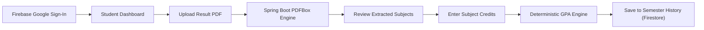

# RIT GPA & CGPA Calculator

A production-grade, full-stack academic web application designed for students of **Rajalakshmi Institute of Technology (RIT), Chennai**, to upload semester result PDFs, automatically extract course records via Apache PDFBox coordinate-based template parsing, enter subject credits, and calculate verified SGPA and cumulative CGPA.

---

## 1. Project Overview & Core Workflow

The application replaces the legacy static calculator with a modern, decoupled client-server architecture:



### Complete End-to-End Flow:
1. **Google Sign-In**: Authenticates students via Google Sign-In using Firebase Authentication (`ritgpacalc`).
2. **Student Dashboard**: Direct redirect upon sign-in. Displays student welcome, latest SGPA, cumulative CGPA, total credits, arrear status, and Recharts GPA trajectory.
3. **PDF Upload**: Drag-and-drop or file browser supporting official RIT result PDFs (validates file size, MIME-type, headers, and coordinate anchors).
4. **Coordinate-Aware Extraction**: Spring Boot 3 & Apache PDFBox 3.x parse document text coordinates and bounding boxes against `rit-result-template.json` (no ML/AI hallucination risks).
5. **Review & Credit Entry**: Editable subject review table. Grades, codes, and multi-line titles are extracted; credits must be entered by the student (never guessed or auto-invented).
6. **Deterministic GPA Calculation**: Applies the standard credit-weighted formula with strict grade points ($O=10, A+=9, A=8, B+=7, B=6, C=5, U=0$).
7. **Firestore Persistence**: Persists verified semester records under `users/{uid}/semesters/{semesterId}` for multi-semester cumulative CGPA calculation.

---

## 2. Technology Stack

### Frontend
- **Framework**: React 18, TypeScript, Vite
- **Styling**: Tailwind CSS (Royal Blue, Sky Blue, Navy palette), Poppins typography (`300..900`)
- **Routing**: React Router v6
- **HTTP Client**: Axios with automated Firebase ID Token bearer interceptor
- **Icons**: Lucide React
- **Analytics / Data Viz**: Recharts (Responsive GPA trend curve)
- **Branding**: Official Rajalakshmi Institute of Technology logo and favicon

### Backend
- **Runtime & Framework**: Java 17 / 21 / 25, Spring Boot 3.3.5
- **Security**: Spring Security with Firebase ID Token authentication filter
- **PDF Engine**: Apache PDFBox 3.0.3 (TextPosition & bounding-box extraction)
- **Validation**: Jakarta Bean Validation (`jakarta.validation-api`)
- **Build Tool**: Apache Maven

### Database & Authentication
- **Authentication**: Firebase Authentication (Google Sign-In, persistent sessions)
- **Database**: Cloud Firestore (`users/{uid}/semesters/{semesterId}`) with resilient in-memory fallback cache

---

## 3. Project Structure

```
RIT-GPA-CGPA-CALCULATOR/
│
├── frontend/
│   ├── public/
│   │   ├── assets/               # Preserved official RIT logos & icons
│   │   ├── favicon.png           # RIT seal favicon
│   │   └── rit-logo.png          # Primary official logo
│   ├── src/
│   │   ├── assets/               # Local bundled assets
│   │   ├── components/           # Navbar, ProtectedRoute, UI components
│   │   ├── context/              # AuthContext (Firebase auth state)
│   │   ├── firebase/             # Firebase SDK client initialization
│   │   ├── pages/                # Dashboard, Upload, Review, Summary, History
│   │   ├── services/             # Axios API client
│   │   └── types/                # TypeScript interfaces & DTOs
│   ├── .env.example
│   ├── package.json
│   ├── tailwind.config.js
│   └── vite.config.ts
│
├── backend/
│   ├── src/
│   │   ├── main/
│   │   │   ├── java/com/rit/gpa/
│   │   │   │   ├── config/       # Security, CORS, Firebase Admin config
│   │   │   │   ├── controller/   # REST Controllers (PDF, GPA, Semesters)
│   │   │   │   ├── dto/          # Request & Response payload records
│   │   │   │   ├── firebase/     # Firestore service & ID token verification
│   │   │   │   ├── gpa/          # Deterministic SGPA & CGPA calculation service
│   │   │   │   ├── model/        # Domain entities (Semester, Subject, Template)
│   │   │   │   ├── pdf/          # PDFBox coordinate text stripper & extractor
│   │   │   │   └── template/     # RitTemplateManager (JSON template parser)
│   │   │   └── resources/
│   │   │       ├── application.yml
│   │   │       └── templates/
│   │   │           └── rit-result-template.json
│   │   └── test/
│   │       └── java/com/rit/gpa/ # JUnit 5 test suite
│   ├── .env.example
│   └── pom.xml
│
├── sample-docs/                  # Reference RIT semester result PDFs
├── .gitignore
└── README.md
```

---

## 4. PDF Extraction Engine & Template Configuration

The extraction rules are completely decoupled from Java logic into `backend/src/main/resources/templates/rit-result-template.json`.

### Coordinate Anchors
- **Page Header**: Verifies `"Rajalakshmi Institute of Technology"` and `"Semester Results"`.
- **Student Details Anchors**: Regex extraction for Student Name, Register Number, Academic Year, Semester, and Course.
- **Subject Table Columns (X-coordinates)**:
  - `subjectSemester`: $x \in [30.0, 122.0]$
  - `subjectCode`: $x \in [122.0, 196.5]$ (Regex: `^[A-Z]{2}[0-9A-Z]{3,6}$`)
  - `subjectTitle`: $x \in [196.5, 409.1]$ (Dynamic multi-line row partitioning)
  - `grade`: $x \in [409.1, 454.5]$ (Supported: `O, A+, A, B+, B, C, U`)
  - `result`: $x \in [454.5, 500.0]$ (`PASS, RA, FAIL, WH, AB`)
  - `examDate`: $x \in [500.0, 570.0]$

### Multi-Line Row Partitioning
Each subject row's vertical boundary is bounded by midpoints between consecutive subject code y-coordinates:
$$\text{Top}(i) = \frac{y_{i-1} + y_i}{2}, \quad \text{Bottom}(i) = \frac{y_i + y_{i+1}}{2}$$
This guarantees that multi-line course titles (e.g., *"Environmental Science for Mechanical Engineers"*) are gathered without font-drift or cross-row collisions.

---

## 5. GPA & CGPA Calculation Methodology

Grade points are configurable in `GradePointConfig.java`:

| Grade | Description | Grade Point |
|:---:|:---|:---:|
| **O** | Outstanding | 10.0 |
| **A+** | Excellent | 9.0 |
| **A** | Very Good | 8.0 |
| **B+** | Good | 7.0 |
| **B** | Average | 6.0 |
| **C** | Satisfactory | 5.0 |
| **U** / **RA** | Re-Appearance / Arrear | 0.0 |

### Formulas:
- **Semester GPA (SGPA)**:
  $$\text{SGPA} = \frac{\sum_{i=1}^{n} (\text{Credits}_i \times \text{GradePoint}_i)}{\sum_{i=1}^{n} \text{Credits}_i}$$
- **Cumulative GPA (CGPA)**:
  $$\text{CGPA} = \frac{\sum_{\text{all semesters}} (\text{Credits} \times \text{GradePoint})}{\sum_{\text{all semesters}} \text{Eligible Credits}}$$

*Note: CGPA is computed from total weighted grade points across all completed semesters, never by averaging semester SGPAs.*

---

## 6. REST API Documentation

All requests can be authenticated using an `Authorization: Bearer <FIREBASE_ID_TOKEN>` header.

### 1. `POST /api/pdf/extract`
Uploads a semester result PDF and extracts student information and subjects.
- **Content-Type**: `multipart/form-data`
- **Body**: `file: [PDF document]`
- **Response**:
  ```json
  {
    "success": true,
    "studentName": "R KATHIRVELAN",
    "registerNumber": "211723106041",
    "academicYear": "2024-2025",
    "semester": "04",
    "course": "B.E. Mechanical Engineering",
    "subjects": [
      {
        "subjectCode": "GE23412",
        "subjectName": "Environmental Science for Mechanical Engineers",
        "grade": "O",
        "resultStatus": "PASS"
      }
    ]
  }
  ```

### 2. `POST /api/gpa/calculate`
Calculates deterministic SGPA from reviewed subjects and user-entered credits.
- **Body**:
  ```json
  {
    "subjects": [
      {
        "subjectCode": "GE23412",
        "subjectName": "Environmental Science for Mechanical Engineers",
        "grade": "O",
        "credits": 2.0
      }
    ]
  }
  ```
- **Response**:
  ```json
  {
    "sgpa": 10.00,
    "totalCredits": 2.0,
    "passedCredits": 2.0,
    "totalGradePoints": 20.0,
    "arrearCount": 0,
    "status": "PASSED"
  }
  ```

### 3. `POST /api/semesters`
Saves an evaluated semester to Firestore under the authenticated student UID.

### 4. `GET /api/semesters`
Retrieves all historical semesters for the authenticated student.

### 5. `GET /api/semesters/{semesterId}`
Retrieves details for a specific semester record.

### 6. `GET /api/gpa/summary`
Calculates latest SGPA, cumulative CGPA, total earned credits, and semester trend for the student dashboard.

---

## 7. Local Development & Setup

### Prerequisites
- Java 17 or higher
- Apache Maven 3.8+
- Node.js 18+ and npm

### 1. Backend Setup
```bash
cd backend
# Run test suite
mvn test

# Start the Spring Boot backend
mvn spring-boot:run
```
Backend runs on `http://localhost:8080`.

### 2. Frontend Setup
```bash
cd frontend
# Install dependencies
npm install

# Start Vite development server
npm run dev
```
Frontend runs on `http://localhost:5173`.

### 3. Building for Production
- **Frontend**: `cd frontend && npm run build` (outputs optimized bundle to `frontend/dist/`)
- **Backend**: `cd backend && mvn package -DskipTests` (outputs runnable JAR in `backend/target/`)

---

## 8. License & Attribution

Designed and developed for **Rajalakshmi Institute of Technology (RIT), Chennai**.  
Grading scales and regulations follow Anna University / Autonomous RIT curriculum guidelines.
